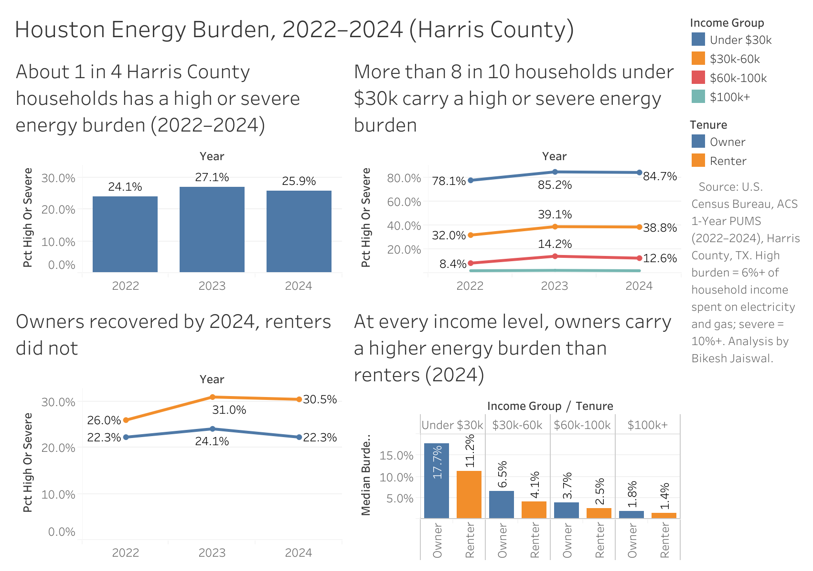

# Houston Energy Burden Analysis (2022–2024)

**How much of their income do Houston-area households spend on electricity and gas, how did that change from 2022 to 2024, and who carries the heaviest load?**

**[View the interactive dashboard on Tableau Public](https://public.tableau.com/views/HoustonEnergyBurden/Dashboard)**

---

## Key findings

- **About 1 in 4 households is struggling.** In 2024, 25.9% of Harris County households had a *high* (6%+ of income) or *severe* (10%+) energy burden. The typical household spent about 3.1% of its income on electricity and gas.
- **2023 was a spike.** From 2022 to 2023, typical yearly energy bills rose about 10% ($2,400 → $2,640) while incomes rose about 6%. The share of households with a high or severe burden rose from 24.1% to 27.1%.
- **The 2024 recovery was uneven.** Bills fell about 4.5% and incomes kept rising, so burden eased overall. Owners returned to their 2022 level (22.3%), but renters (26.0% → 31.0% → 30.5%) and households earning under $30k (78.1% → 85.2% → 84.7%) stayed at the higher level.
- **Low-income households carry the heaviest load.** About 85% of households earning under $30k had a high or severe burden in 2024, with a typical burden of about 13% of income, roughly 4 times the county median.
- **Renters look worse overall, but owners are worse at the same income.** At every income level in 2024, owners had a higher median burden than renters (for example, under $30k: 17.7% vs 11.2%). Renters only look worse overall because more of them have low incomes. This is an example of Simpson's paradox.

## What this means

- Energy assistance should be targeted by **income** first, since income is the strongest driver of burden.
- **Low-income homeowners** are easy to overlook, because programs often focus on renters. Their median burden is the highest of any group (about 17.7%).

## Data

- **Source:** [U.S. Census Bureau, American Community Survey (ACS) 1-Year Public Use Microdata Sample (PUMS)](https://www.census.gov/programs-surveys/acs/microdata.html), Texas household files, 2022, 2023, and 2024
- **Area:** Harris County, TX (39 PUMAs: 04601–04640, excluding 04632, from the 2020 PUMA map)
- **Unit:** one row per household, weighted with the household weight (`WGTP`)
- **Size:** about 13,000–13,700 households per year after cleaning, representing about 1.63 million households

The raw PUMS files are too large for GitHub. Download them from the [Census PUMS data page](https://www2.census.gov/programs-surveys/acs/data/pums/) (`<year>/1-Year/csv_htx.zip`) to rerun the notebook.

## Method

1. **Load** 9 columns from each year's Texas household file: `PUMA, HINCP, ADJINC, ELEP, ELEFP, GASP, GASFP, TEN, WGTP`
2. **Filter** to the 39 Harris County PUMAs
3. **Clean:**
   - Remove vacant homes and group housing (`TEN` blank)
   - Remove households with zero or negative income
   - Keep only households that pay their own electricity bill (`ELEFP = 3`)
   - Keep gas codes 2, 3, and 4; drop gas included in rent (cost unknown)
   - Gas cost = `GASP` only when `GASFP = 4`; otherwise $0 (no gas, or already included in the electricity bill)
4. **Calculate:**
   - Income = `HINCP × ADJINC / 1,000,000`
   - Energy burden = (monthly electricity + gas) × 12 ÷ income
   - High burden = 6%+; severe = 10%+
5. **Summarize with household weights:** weighted median burden and the weighted share of households with high or severe burden, by year, tenure (owner/renter), and income group

## Limits

- This is survey data (a sample), so year-to-year changes of about 1 percentage point may be random noise.
- Households whose utilities are included in rent were removed because their real energy cost is unknown. Renter results only cover renters who pay their own bills.
- About 1% of households reported energy costs above their income. They were kept, which slightly raises the "severe" share.
- Dollar amounts are in each year's own dollars, not adjusted for inflation. Burden is a ratio, so it is not affected.
- The data shows *what* changed, not *why*. The 2023 spike may relate to extreme summer heat or energy prices, but this analysis does not prove the cause.
- Results are for Harris County as a whole, not individual neighborhoods or the City of Houston.

## Files

| File | What it is |
| --- | --- |
| `energy_burden.ipynb` | Full analysis in Python (Google Colab) |
| `result_overall.csv` | Burden by year |
| `result_by_tenure.csv` | Burden by year and owner/renter |
| `result_by_income.csv` | Burden by year and income group |
| `result_by_income_tenure.csv` | Burden by year, income group, and owner/renter |
| `dashboard.png` | Dashboard screenshot |

## Tools

Python (pandas) in Google Colab · Tableau Public · Google Drive

## Author

**Bikesh Jaiswal**, BBA in Management Information Systems, University of Houston-Downtown (May 2027)
